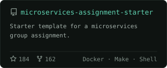
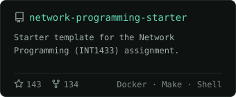
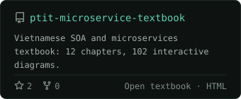
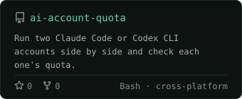
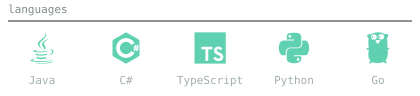
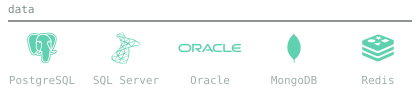
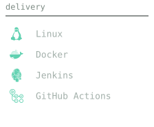

<picture>
  <source media="(prefers-color-scheme: dark)" srcset="assets/banner-dark.svg">
  <source media="(prefers-color-scheme: light)" srcset="assets/banner-light.svg">
  
</picture>

> The best way to learn is to teach, and the best way to teach is to build.

### about

Lecturer at PTIT, Hanoi, and backend engineer. I build service-oriented and distributed systems, and teach students to design, ship, and run them.

```text
focus     backend, distributed systems
teaching  microservices, networking
research  information theory, MIMO, LDPC
```

### now

<!-- NOW:START -->
- [`network-programming`](https://github.com/hungdn1701/network-programming) — Lập trình mạng (INT1433) — khung học phần, bản xem trước bài... <sub>pushed 2026-10-26</sub>
- [`mobile-app-starter`](https://github.com/hungdn1701/mobile-app-starter) — Starter template for Mobile Application Development (INT1449)... <sub>pushed 2026-10-13</sub>
- [`dna-receiver-checks`](https://github.com/hungdn1701/dna-receiver-checks) — Reference Python components for DNA-storage receiver bit orde... <sub>pushed 2026-09-20</sub>
<!-- NOW:END -->

<sub>Refreshed daily from my public repositories.</sub>

### selected work

<p>
  <a href="https://github.com/hungdn1701/microservices-assignment-starter"><picture>
    <source media="(prefers-color-scheme: dark)" srcset="assets/cards/microservices-assignment-starter-dark.svg">
    <source media="(prefers-color-scheme: light)" srcset="assets/cards/microservices-assignment-starter-light.svg">
    
  </picture></a>
  <a href="https://github.com/hungdn1701/network-programming-starter"><picture>
    <source media="(prefers-color-scheme: dark)" srcset="assets/cards/network-programming-starter-dark.svg">
    <source media="(prefers-color-scheme: light)" srcset="assets/cards/network-programming-starter-light.svg">
    
  </picture></a>
  <a href="https://github.com/hungdn1701/ptit-microservice-textbook"><picture>
    <source media="(prefers-color-scheme: dark)" srcset="assets/cards/ptit-microservice-textbook-dark.svg">
    <source media="(prefers-color-scheme: light)" srcset="assets/cards/ptit-microservice-textbook-light.svg">
    
  </picture></a>
  <a href="https://github.com/hungdn1701/ai-account-quota"><picture>
    <source media="(prefers-color-scheme: dark)" srcset="assets/cards/ai-account-quota-dark.svg">
    <source media="(prefers-color-scheme: light)" srcset="assets/cards/ai-account-quota-light.svg">
    
  </picture></a>
</p>

### stack

<p>
  <picture>
    <source media="(prefers-color-scheme: dark)" srcset="assets/stack-languages-dark.svg">
    <source media="(prefers-color-scheme: light)" srcset="assets/stack-languages-light.svg">
    
  </picture>
  <picture>
    <source media="(prefers-color-scheme: dark)" srcset="assets/stack-data-dark.svg">
    <source media="(prefers-color-scheme: light)" srcset="assets/stack-data-light.svg">
    
  </picture>
  <picture>
    <source media="(prefers-color-scheme: dark)" srcset="assets/stack-delivery-dark.svg">
    <source media="(prefers-color-scheme: light)" srcset="assets/stack-delivery-light.svg">
    
  </picture>
</p>

### activity

<picture>
  <source media="(prefers-color-scheme: dark)" srcset="https://raw.githubusercontent.com/hungdn1701/hungdn1701/output/snake-dark.svg">
  <source media="(prefers-color-scheme: light)" srcset="https://raw.githubusercontent.com/hungdn1701/hungdn1701/output/snake-light.svg">
  
</picture>

### elsewhere

Research, publications and teaching: [hungdn1701.github.io](https://hungdn1701.github.io) · [Google Scholar](https://scholar.google.com/citations?user=1MairvkAAAAJ) · [ORCID](https://orcid.org/0000-0001-6360-2824)
Email: [hungdn@ptit.edu.vn](mailto:hungdn@ptit.edu.vn)
